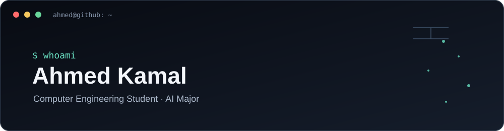
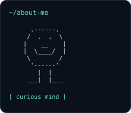
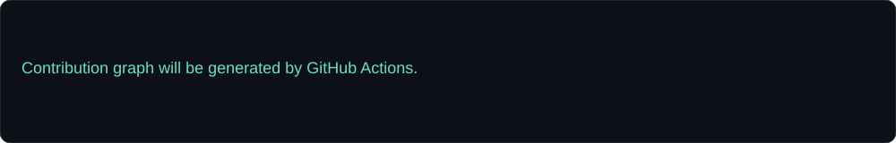
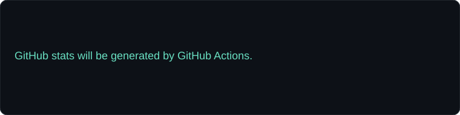

<div align="center">



<br/>

[](https://portfolio-two-pied-42.vercel.app/)
[](https://linkedin.com/in/ahmedkamalr)
[](https://github.com/ahmedkamalrezk)

</div>

---

### `ahmed@github ~ $ whoami`



```text
Ahmed Kamal
Computer Engineering Student | Artificial Intelligence Major

I enjoy building practical software, exploring AI,
and turning ideas into useful products.

Currently focused on:
  > Software development
  > Artificial intelligence
  > Building and improving real-world projects
```

<br clear="right"/>

---

### `ahmed@github ~ $ ./contributions.sh`

<div align="center">



</div>

---

### `ahmed@github ~ $ ./projects.sh`

<table>
<tr>
<td width="50%" valign="top">

#### ◈ Lektra

An offline-first student planner designed to keep a semester organized.

- Timetable and calendar
- Subject folders and study materials
- Voice entry in Arabic and English
- Installable Progressive Web App

[View repository →](https://github.com/ahmedkamalrezk/Lektra)

</td>
<td width="50%" valign="top">

#### ◈ PC-Assistant

A Python voice assistant that helps control a PC using voice commands.

- Speech recognition
- Online and offline voice input
- Open apps and websites
- Voice responses

[View repository →](https://github.com/ahmedkamalrezk/PC-Assistant)

</td>
</tr>
<tr>
<td colspan="2" valign="top">

#### ◈ The-Cave

A JavaScript project. Explore the source code and implementation.

[View repository →](https://github.com/ahmedkamalrezk/The-Cave)

</td>
</tr>
</table>

---

### `ahmed@github ~ $ ./stats.sh`

<div align="center">



</div>

---

### `ahmed@github ~ $ tech_stack`

<div align="center">


</div>

---

<div align="center">

```text
"Building, learning, and turning ideas into reality."
```

<sub>Generated with Python · Updated automatically by GitHub Actions</sub>

</div>
